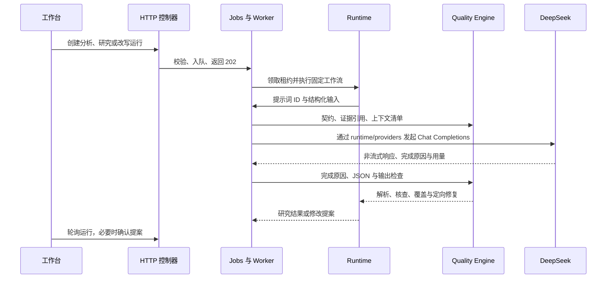

# 当前 DeepSeek 调用链

以下路径从项目根目录 `F:\ai-knowledge-workspace` 起算。证据使用当前文件指纹与实际运行记录。

## 代码定位与数据

| 层 | 文件与符号 | 输入、输出与约束 |
| --- | --- | --- |
| UI 和代理 | `packages/client/src/workspace/document-analysis.tsx`、`workflows.tsx`、`workspace-app.tsx`，`apps/web/next.config.ts` | 工作台提交 JSON。Web 走同源代理，Windows 和移动端走各自的平台适配。按运行 ID 轮询。 |
| HTTP | `apps/api/src/http/controllers.ts` 中 `RunsController.create` 对应研究、`CoreController.analysis` 和 `CoreController.selection` 对应文档任务，具体路由见下表 | `authenticate` 绑定服务端身份，Zod 解析目标、来源、版本、选区和外部授权。返回 `run_id/status_url/events_url` 与 HTTP 202。 |
| 入队与执行 | `apps/api/src/domain/jobs.ts` 的 `research/analysis/selection`、`enqueueIn`、`next`、`execute`、`executeAnalysis` | 用租户/Workspace/角色与任务契约创建任务。Worker 领取，检查权限和原始请求指纹，分派工作流。 |
| 工作流 | `runtime/agent.ts::runAgent`、`runtime/document-research.ts::researchDocument`、`runtime/selection.ts::rewriteSelection` | 传 `PromptId` 和当前步骤负载。不同阶段有各自的 Goal、摘录、候选、覆盖项或改写选区。 |
| 提示词与上下文 | `quality-engine/prompts.ts::prompts`、`task-contract.ts::verifyTaskContract`、`context-manifest.ts::contextManifest` | 服务端模板提供 system 消息，当前阶段序列化 JSON 提供 user 消息。记录 prompt ID、版本、schema、模型配置摘要、上下文摘要、证据快照 ID。 |
| 授权、预算、重试 | `domain/jobs.ts::callModel/modelAttempt`、`domain/ai-evidence.ts::readAiEvidence`、`runtime/budget.ts::reserveModelBudget` | 每次调用重新检查外部策略、文档基线和本地证据的来源、范围及最新快照。保守字节预算预留，供应商响应后按实际用量结算。 |
| 适配器 | `runtime/providers.ts::modelGateway/deepseekGateway/providerJson` | 从配置选定模型，使用 HTTPS 与 Bearer 请求。响应经 512 KB 上限和 Zod 信封解析，返回 `text/input/output/model/provider/finishReason`。 |
| 输出与提交 | `quality-engine/model-output.ts::completionText`，`document-quality.ts`、`research-quality.ts`、`selection-review.ts`，`domain/artifacts.ts::proposeIn/resolve` | 完成原因和 JSON 先通过，之后执行任务 schema 与证据检查。分析、改写提案采纳前检查基线和证据收据。研究创建新 Artifact，Claim 以 proposed 写入。 |

| 操作 | HTTP 入口 |
| --- | --- |
| 即时问答或研究 | `POST /v1/research-runs`，`mode=simple/research` |
| 文档分析 | `POST /v1/artifacts/:id/analysis-runs` |
| 选段改写 | `POST /v1/artifacts/:id/ai-patch-runs` |
| 人工采纳 | `POST /v1/artifacts/:id/patches/:patchId/accept` |

## 当前线上协议和故障行为

- 固定 `POST https://api.deepseek.com/chat/completions`，使用 `DEEPSEEK_MODEL`，默认 `deepseek-flash`，实际诊断模型另见 [证据 JSON](PHASE_00_RUN_EVIDENCE.json)。显式 `thinking.type=disabled`，每次两条消息，传 `max_tokens`，JSON 阶段使用 `response_format.type=json_object`。即时回答用文本。当前无流式解析、对话历史、tool schema、reasoning 状态回传或 JSON Schema 响应约束。采纳未来端点需重新核对协议。 [DeepSeek Chat Completions](https://api-docs.deepseek.com/api/create-chat-completion/) · [JSON Output](https://api-docs.deepseek.com/zh-cn/guides/json_mode/)
- Adapter 合并任务取消信号与单次 40 秒超时。网络和超时可重试。401/403 映射认证失败，402 映射余额，429 可重试，5xx 可重试。协议结构错误单独标记。Jobs 在预算允许时仅做一次 400 毫秒固定等待重试。当前未处理 Retry-After、抖动或按上游错误体分类上下文过长。
- 结构可解析但 `finish_reason=length` 仍拒绝。空字符串、空白、非法 JSON 对象、资源不足和其他停止原因分流。文档规划和初稿对可恢复格式失败各有一次修复。资源不足允许通用重试。结构有效的输出仍必须通过各任务的引用和语义门控。
- 审计关联点为 HTTP `X-Trace-Id`、`run_id`、调用序号、`ContextSnapshotCreated`、`ModelInvocationCompleted/Failed`、`QualityGateFailed`。HTTP trace ID 与上游 request ID 未形成端到端关联。已收到用量的拒绝响应也写入 `model_usage`。上游无用量时，保留调用前的预算占位。
