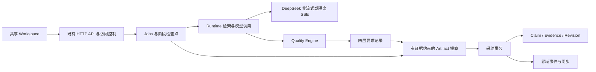

# v2.0 接续架构与 ADR

| 决策 | 现行实现 |
| --- | --- |
| ADR 01 执行与验证分离 | 复用 SQL Jobs、NestJS、共享客户端。Runtime 与 Quality Engine 同级。官方 Cordis Session/Agent Loop 已独立验证可导入，应用继续使用契约重实现。 |
| ADR 02 兼容与原子要求 | API 继续返回原 `coverage`，新结果增加 `requirement_ledger`。用户可用每行「问题组 > 子问题」明确叶项，指定来源与必需许可图独立入账。自动拆题仍依赖 planner，复杂要求需人工核对。 |
| ADR 03 覆盖映射 | 机器规则与模型语义核验协作。来源 DOI 或 URL 匹配独立于语义判断；匹配回答的位置映射到 evidence/claim/block ID；采纳时按实际插入块反向验映射并记录 Revision ID。 |
| ADR 04 知识与公式 | 采纳事务持久化 proposed Claim 和 evidence 关系。用户更改内容后清除失效的 AI 标识。纯文本 MathML 抽取保留指数，可识别科学计数法转为含尾数/指数的 LaTeX inline。 |
| ADR 05 Session | 保持安全事件游标和检查点。工具中段按步骤重试，完整模型历史及协议状态耐久化仍待独立设计。 |
| ADR 06 发布 | 真实用户流量维持旧 Runtime 默认。无写入对照、回退测试、实库小样本和模拟器在隔离环境运行。应用数据库 schema 本轮无变更。 |

关键入口为 [document-research.ts](../../apps/api/src/runtime/document-research.ts)、[requirement-ledger.ts](../../apps/api/src/quality-engine/requirement-ledger.ts)、[research-operators.ts](../../apps/api/src/quality-engine/research-operators.ts)、[document-analysis.ts](../../apps/api/src/domain/document-analysis.ts)、[artifacts.ts](../../apps/api/src/domain/artifacts.ts) 与 [共享验收面板](../../packages/client/src/workspace/document-analysis.tsx)。
