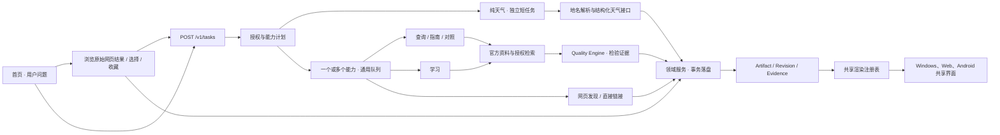

# AI Knowledge Workspace 项目架构书

**前端设计交接 · 2026-11-14**

工作空间面向人们在浏览器里完成的工作：找网页、阅读和收藏资料、对照来源、处理文档、作决定并回访结果。用户可直接浏览来源，也可用自然语言让系统组织工作。一次任务可组合多个能力。Artifact 保存有价值的工作成果、出处与版本。

## 1. 产品范围与设计画面

| 浏览器工作 | 目标体验 | 当前实现 |
| --- | --- | --- |
| 寻找网页 | 搜关键词或打开已知 URL，浏览原始结果 | 「浏览来源」直出带出处的列表；优先网页搜索，缺少配置时回落公开目录，可粘贴 URL。 |
| 阅读、收集、研判 | 保留多份资料，对照它们，引用之后仍能回原网页 | 打开原网页、个人收藏、将选中的网页保存为选集。选中的可读网页可作为生成依据。简单对照可生成对照表。 |
| 查询动态信息 | 直接拿到数据、时间范围、地点和出处，再回来刷新 | 天气接入结构化供应方。后续可用同样的注册契约接入汇率、公告、行程等有明确数据来源的服务。 |
| 组织与制作 | 导入已有资料、提取信息、形成可修改与分享的成果 | 复用来源中心、文档、图表、引用、导出和学习产物。组合任务可同时生成不同类型模块。 |
| 使用浏览器服务 | 登录站点、使用邮件或协作工具、填写表单、处理交易 | 当前可跳转系统浏览器继续。工作台内多标签与会话、网站交互结果回流属于待实现能力。 |
| 跟进与回访 | 保留进度、重访相关网页、查看更新或回到交付时采用的版本 | 用现有收藏、Artifact 历史、来源监测与快照刷新。通用浏览历史与标签恢复待实现。 |

这些是用户动作，首页保留一个入口。同一个问题可以包含多个动作，同一个动作也可以在多个场景中复用。例子中模块是交互设计目标，具体在线覆盖以本节状态和验收为准。

| 用户想完成的事 | 在浏览器里实际怎样做 | 工作空间应呈现的内容 |
| --- | --- | --- |
| 为周末行程找交通和场馆 | 查预报、打开场馆与交通服务、比较时段、预约 | 日期与地点约束、可刷新的数据卡、场馆和路线对照、原站预约入口。实时交通、地图和预约仍需接入。 |
| 比较几台笔记本，再发给同事 | 查产品页、核对配置和价格、排除超预算项、发链接 | 同一口径的比较表、采集时间、推荐理由及来源附件。现有支持简单文本对照与分享产物，价格监测和对外发送需各自接入。 |
| 处理供应商的申请或报销 | 在登录站点查表单，阅读说明，整理附件，填写并提交，保存回执 | 站点会话、所需资料、填写状态、送审预览与回执。现有可收集公开说明与整理资料，登录站点和提交由系统浏览器接续。 |
| 根据两份 PDF 和一张表准备会议 | 打开资料并定位原文，抽取数据，制作比较表、说明和附件 | 可编辑的结论、源文定位、表格、待决项与导出。已有多格式导入、编辑和导出，复合任务内的数据依赖编排仍待补齐。 |

### 首屏与产物画面

| 画面 | 用户先看到 | 用户下一步 | 系统如何选择组件 |
| --- | --- | --- | --- |
| 工作台 | 一个自然语言输入框、必要的联网授权、最近产物 | 浏览网页结果或生成产物 | 用户无需选择模型、供应方或产物类型。手动创建项目和文档是次级入口。 |
| 网页结果 | 标题、站点、出处，检索范围与可用摘要 | 打开原网页、收藏、勾选资料，保存选集或基于所选资料生成 | 原始结果独立于生成。公开目录与通用网页搜索有不同覆盖标识。 |
| 组合产物 | 一份产物里的多个模块，原文入口与部分缺项 | 执行不同部分、逐块刷新天气、回读出处 | 一个目标可产生天气、步骤、网页等模块，各模块使用同一 Artifact 与版本链。 |
| 天气产物 | 地点与所属地区、时区、数据获取时间、选定日期的预报 | 看逐日概览、展开逐小时、查出处、刷新 | 查今天可显示供应方天气模型提供的当前数据。查明天或之后时优先显示该日期。逐日列出最低／最高气温和最高降水概率。 |
| 操作指南／信息产物 | 直接答案、适用条件、可定位出处 | 按步骤操作、确认结果或打开原文 | 操作指南用编号步骤。事实检索用不同角度的内容段落。只取得资料时展示摘录和可打开的出处。 |
| 学习产物 | 学习目标、学习起点、下一节 | 阅读、切换图谱或时间线、作答、继续提问 | 按任务选择先修关系、公式、文献时间线、路径表与练习。追问更新同一 Artifact。 |

**主次顺序。** 大屏以主内容为中心，目录和来源可放在辅助栏。窄屏优先展示答案或操作步骤，把原文检查器作为随时返回的次级面板。天气的逐日与逐小时来自同一组数据。指南每步都有自己的引用，设计时应保留引用与步骤的邻接关系。

**公共工具。** 版本、编辑、离线缓存、分享链接和导出沿用工作台。复习卡仅出现在适合的场景。原型可调整布局、颜色和密度，键盘顺序、程序化可读的状态、表格标题、字段单位和来源入口需要保留。

**后续浏览区的界面槽位。** 设计可预留地址输入、标签页与站点状态栏，侧栏承接查看出处、摘录、加入选集和移交任务。浏览会话保存导航进度与临时上下文，Artifact 保存用户决定带走的资料及成果。Windows 的系统浏览器跳转继续作为当前交互。站点登录接入、下载管理和自动填写尚无实现，设计可先给出界面草图。

## 2. 业务流程



1. **提交与路由。** 请求提供 Workspace ID、目标文本和本次外部调用授权。服务端当前用规则识别显式分隔的子任务，每个子任务选用一个能力。计划总计最多五步。天气、资料检索、操作步骤、对照、网页发现与学习是可组合的处理能力。单能力任务可走原有快速路径。首次提交有幂等键。缺少天气城市时提示补充，同名地点返回少量候选。选择候选仅补地点，保留原来的相对日期。
2. **取数与核验。** 天气的数字由供应方 JSON 提供，不经过模型。独立短任务 Worker 避免被长研究堵住。指南优先使用官方说明，普通问题调用机构资料、百科和学术索引，配置搜索后可扩大公开网页覆盖。通用查询先按主题给来源排序，候选答案由验证阶段检查。摘录回退只保留匹配主题的材料、用户明确选择的链接或权限内的本地资料。用户明确要求使用自己的资料时，通用信息路径可以纳入工作空间内符合权限的原文证据。
3. **完成与保存。** 复合任务逐项保存已获得的中间结果。受证据或权限限制的子项显示明确缺口，其余模块仍可进入同一产物。Worker 结束时复核权限、证据和租约。创建 Artifact、保存 Revision、写入出处和发出同步事件在同一事务边界内。天气刷新使用原地点坐标与日期跨度，采用刷新时的当地相对日期；更新同一个天气块和 Artifact，历史版次保留旧快照。并发编辑造成版次过期时返回 409。
4. **展示与编辑。** 前端按块类型渲染。天气的行、温度、降水概率和时间点来自 schema，空值显示「—」。指南与一般信息的可编辑文本仍使用既有编辑与同步机制。学习追问与练习沿用学习领域逻辑。
5. **来源与失败。** 一键打开 Evidence 展示对应的原文、链接或已整理的数值快照。外部服务失败时保留已有正式版。资料不足时清楚区分已定位的参考材料与已经回答的问题，不补造步骤或数据。

### 扩展边界

1. 新增网页、地图、实时数据或文件处理能力时，定义输入、所需权限、输出、来源、过期条件，以及失败时前端可呈现的内容。注册后端执行器和必要的结构化块，沿用同一输入框、任务状态和产物版本。当前计划由固定注册项和规则构建。下一步可以让规划器发现注册能力，并表达前后依赖，由服务端校验每步参数、权限和预算。
2. 浏览器会话应由各端宿主管理导航、站点权限、标签和会话存储。页面内容可在用户选定后作为资料进入工作空间，页面中的操作指令和登录凭据留在相应站点边界内。前端设计把浏览会话、来源阅读器和 Artifact 作为同一工作台里的不同区域。
3. 需要改动外部系统时，把准备阶段与提交阶段建模为独立事件。以提交表单为例，先呈现目标站点、账号、表单内容和附件，用户确认后再提交，按幂等键保存结果与回执。写入服务的成功与否独立于本地 Artifact 的保存状态。

### 状态与文案

| 状态 | 设计动作 |
| --- | --- |
| 输入为空或缺少地点 | 同一表单提示一处缺项。保留用户输入。 |
| 授权、无权限、离线 | 初次联网需明确同意。Owner 有权限设置入口。离线仍可读本机已缓存的产物。 |
| 排队与检索中 | 表单确认提交后隐藏上次打开按钮，展示当前任务进度。保持屏幕阅读器可读的状态区域。 |
| 同名地点 | 候选列表显示城市与行政区，点击填入已选地点，保留原问题、日期及授权动作。 |
| 完成 | 展示「打开产物」。正文默认显示适合该任务的主信息，只提供实际有内容的视图。 |
| 部分完成 | 可打开参考资料。操作指南只在步骤完整时使用执行顺序编号。 |
| 过期快照 | 显示获取时间及超过刷新间隔的状态。可刷新。请求失败保留旧快照和原获取时间。 |
| 冲突、删除或旧版本 | 提示打开更新后的版次。历史、缓存与当前版次分别显示，刷新按钮只用于当前可编辑版本。 |

## 3. 文件目录树

```text
F:/ai-knowledge-workspace/
├─ apps/
│  ├─ api/
│  │  ├─ migrations/                       # PGlite / PostgreSQL 共用迁移
│  │  ├─ src/http/
│  │  │  ├─ controllers.ts                  # 任务、产物、同步、证据入口
│  │  │  └─ openapi.ts
│  │  ├─ src/domain/
│  │  │  ├─ jobs.ts                         # 幂等、任务状态、工作区授权及租约
│  │  │  ├─ jobs/composition-execution.ts    # 能力注册、处理计划、合并块
│  │  │  ├─ jobs/information-execution.ts    # 资料编译、天气快照与版本更新
│  │  │  ├─ workspace-browsing.ts           # 网页入口、资料选集
│  │  │  ├─ jobs/learning-execution.ts
│  │  │  ├─ artifacts.ts                    # 统一内容、版本、Patch
│  │  │  ├─ workspace-references.ts          # 引用与原文投影
│  │  │  ├─ exports.ts
│  │  │  └─ sync.ts
│  │  ├─ src/runtime/
│  │  │  ├─ task-routing.ts
│  │  │  ├─ weather-provider.ts
│  │  │  ├─ information-retrieval.ts
│  │  │  ├─ public-research.ts
│  │  │  ├─ learning-workflow.ts
│  │  │  └─ harness/
│  │  ├─ src/quality-engine/
│  │  │  ├─ prompts.ts
│  │  │  ├─ information-relevance.ts        # 通用查询的来源排序与摘录门槛
│  │  │  ├─ requirement-ledger.ts
│  │  │  └─ learning-quality.ts
│  │  └─ src/worker/loop.ts
│  ├─ web/                                  # Next.js 宿主
│  ├─ windows/                              # Tauri / WebView2、原生 SQLite
│  └─ mobile/                               # Android Capacitor 宿主
├─ packages/
│  ├─ contracts/src/
│  │  ├─ index.ts                            # ArtifactDocument 与版本化块
│  │  ├─ productivity.ts                     # Task、天气、指南契约
│  │  ├─ learning.ts
│  │  └─ projection.ts
│  └─ client/src/
│     ├─ lib/api.ts、lib/local-repository.ts
│     └─ workspace/
│        ├─ workspace-app.tsx                 # 工作台与页面调度
│        ├─ task-experience.tsx               # 入口、状态、天气渲染与刷新
│        ├─ artifact-renderer.tsx             # 可替换的 BlockRendererRegistry
│        ├─ document-canvas.tsx               # 按当前 Artifact 水平切换视图
│        ├─ workspace-inspector.tsx           # 引用、来源、文档目录
│        └─ learning-experience.tsx
├─ scripts/windows-productivity-smoke.mjs
└─ docs/engineering/PRODUCTIVITY_WORKSPACE_ARCHITECTURE.md
```

## 4. 与前端交接的数据契约

设计稿按组件状态与示例 JSON 校对。运行时可从 `GET /v1/openapi.json` 读取 OpenAPI。任务、网页和天气字段由共享 Zod schema 校验。新块通过同一个注册表接入，使用版本字段向后兼容。 [共享生产力契约](../../packages/contracts/src/productivity.ts) · [OpenAPI 入口](../../apps/api/src/http/openapi.ts)

| 接口 | 数据与用途 |
| --- | --- |
| `POST /v1/browse/search` | `{workspace_id,query,allow_external:true}`。返回 `results` 和真实搜索覆盖 `coverage`。此动作不生成文档。 |
| `POST /v1/browse/collections` | `{workspace_id,title,items:[{title,url}]}`。返回由所选链接组成的 Artifact。个人收藏走既有 `POST /v1/capture-items`。 |
| `POST /v1/tasks` | `{workspace_id,goal,allow_external:true,location?,sources?}`。返回 202 和追踪 URL。复合任务附 `steps[]`。资料型任务可指定选中的公开网页 URL。 |
| `GET /v1/tasks/{id}` | `status`、`stage`、`mode` 与 `result`。完成读取 `artifact_id`。地点歧义读取 `options`。部分完成可读 `gaps[]`。 |
| `GET /v1/tasks/{id}/events` | 持久化执行事件。当前首屏用状态轮询。 |
| `GET /v1/artifacts/{id}` | 读取标题、当前 Revision 与 `revision.content_json.blocks`。 |
| `GET /v1/artifacts/{id}/projection` | 读取可跳转的来源、原文、关系与知识节点。 |
| `GET /v1/evidence/{id}` | 证据定位。全文按现有 Source Reader 能力打开。 |
| `POST /v1/artifacts/{id}/weather-refresh` | `{base_revision_id,block_id?,allow_external:true}`。排队更新原 Artifact，可轮询上述状态接口。 |

| Block | 设计字段 |
| --- | --- |
| `weather_forecast` | `attrs.place`、`timezone`、`captured_at`、`expires_at`、`window`、`current`、`days`、`hours`。当地时刻无 UTC 后缀。获取时间是 UTC。温度 °C、风速 km/h、湿度和降水概率为百分数。引用在 `children`。 |
| `information_summary` | `attrs.mode`、`goal`、`scope`。答案文本及引用在 `children`。 |
| `task_gap` | `attrs.goal`、`attrs.code`，标记某个组合子项只取得部分资料或未成功。 |
| `guide_step` | `attrs.number`、`title`。步骤文字和引用在 `children`。 |
| `evidence_network` / `graph_embed` / `timeline` | 同一版次与投影接口供给。图和时间线可反向定位有效证据。 |
| `learning_goal` / `learning_lesson` | 可调整的学习起点、课程目标、先修块、公式和练习。个人成绩通过专门接口查询。 |

一条复合请求的接口示例。工作区、运行和产物 ID 由 API 生成或从当前会话取得。

```json
{
  "workspace_id": "0bb8a889-acbc-4c33-8844-cd9454886dad",
  "goal": "北京明天天气；Windows 11 如何截图？；打开网页 https://example.org/",
  "allow_external": true
}
```

正式产物可同时含 `weather_forecast`、`information_summary`、`guide_step`、带 `external_link` 的 `paragraph` 与 `evidence_network`。某个子任务失败时，相应位置可成为 `task_gap`。网页结果里的引用链接和用于支持主张的 Evidence 是两种交互，前者打开原网页，后者定位该结论实际引用的内容。

## 5. 核心代码摘录

### 加入新能力时复用同一计划和产物

```ts
type Capability<T> = {
  prepare: (context: Work) => Promise<T>
  compile: (sql: Sql, context: Work, value: T) => Promise<Produced>
  partial?: (value: T) => boolean
}

for (const unit of units) {
  const output = state.completed[unit.slot]!;
  if (output.ok) {
    const compiled = await capabilities[unit.step.capability].compile(sql, unit, output.value);
    content.blocks.push(...compiled.blocks.filter(block => block.type !== 'evidence_network'));
  }
}
```

摘录保留真实接口并省略权限、失败检查点和关系节点合并。新能力在后端注册输入、准备数据、正式块和缺口语义，在共享契约中增加必要字段，再由前端注册块视图。需要登录、付款、表单提交和发送消息的能力，应先定义用户身份、预览、明确确认、幂等和审计接口，当前发布未执行这些网站动作。 [能力注册与事务发布](../../apps/api/src/domain/jobs/composition-execution.ts) · [计划](../../apps/api/src/runtime/task-routing.ts) · [Worker](../../apps/api/src/worker/loop.ts)

### 同一 Artifact 的天气刷新

```ts
const current = await artifacts.get(actor, existing.id, sql);
if (current.revision.id !== input.base_revision_id)
  throw conflict('CONFLICT_ARTIFACT_VERSION', 'The forecast artifact has changed');
const previous = current.revision.content_json.blocks.find(item => item.type === 'weather_forecast' && (!input.block_id || item.id === input.block_id));
// previous 存在时，在同一事务内替换该块并提交新 Revision
await artifacts.editIn(sql, actor, current, {
  base_revision_id: current.revision.id,
  operations: [{ type: 'update_block', block_id: previous!.id, block: { ...block, id: previous!.id } }],
}, 'agent');
```

[版本写入](../../apps/api/src/domain/jobs/information-execution.ts) · [天气供应方](../../apps/api/src/runtime/weather-provider.ts)

### 更换前端样式的入口

```tsx
const nextRegistry = createArtifactRendererRegistry({
  weather_forecast: ProductWeatherCard,
  guide_step: ProductGuideStep,
});
return <ArtifactRendererProvider registry={nextRegistry}>
  <WorkspaceApp />
</ArtifactRendererProvider>;
```

此段展示注册方式。新视觉组件实现 `BlockRendererProps`，从 `block` 读取数据，从 `context.onEvidence(id)` 打开原文。设计层不要重新计算天气、猜测用户任务或从文案解析字段。 [注册表与内置组件](../../packages/client/src/workspace/artifact-renderer.tsx) · [页面状态](../../packages/client/src/workspace/task-experience.tsx)

## 6. 发布与验收

Windows 原生客户端通过 `npm run test:windows:productivity` 完成一轮真实联网验收。计时为单次样本，从提交到打开入口可用。本地 API 与验收数据独立运行。

| 实际操作 | 验收结果 | 本次耗时 |
| --- | --- | --- |
| 查询北京未来三天天气 | 逐日与逐小时表完整，来源可打开 | 2.18 秒 |
| 在天气产物里刷新 | 同一产物形成第 2 版，第 1 版保留 | 0.87 秒 |
| 查询 Springfield 明天天气 | 出现同名地点候选，选择 Illinois 后保留「明天」 | — |
| 询问 Windows 11 如何截图 | 3 个可执行步骤，能打开 Microsoft 支持资料 | 1.95 秒 |
| 查询图神经网络及适用任务 | 显示定义、结构和常见任务，主要段落带出处 | 7.09 秒 |
| 组合天气、指南和网页 | 在同一 Artifact 中出现三个模块 | 4.07 秒 |
| 粘贴网页地址并收集 | 显示原网页链接，单独收藏，并保存可编辑的资料选集 | — |

[Windows 产物截图](../../.data/productivity-qa/native-0lvO2U/composite.png) · [天气截图](../../.data/productivity-qa/native-0lvO2U/weather.png) · [通用查询截图](../../.data/productivity-qa/native-0lvO2U/information.png) · [本地运行记录](../../.data/productivity-qa/native-0lvO2U/results.json)

类型检查和 lint 通过。API 自动测试 59 项、Web 端到端回归 8 项通过。一次先行联网回归中天气服务临时失败，复合产物保留其它两个模块并展示天气缺项。随后为固定只读天气请求加入一次有总时限的瞬时错误重试，使用模拟 503 验证恢复，并完成上表所列的真实联网复测。早期普通查询的摘录中出现过与主题弱相关的供应链论文，针对该例增加了相关性测试，同题复测生成了直接答案。少量模型生成的适用范围标签仍可能混用语言。

学习场景在 Windows 原生客户端复测通过。晶体材料 GNN 目标生成 4 节课程，包含图谱、时间脉络和公式。练习结果独立保存，追问更新同一产物至第 2 版。 [学习截图](../../.data/learning-qa/native-FL8nU6/learning-workspace.png)

**数据边界。** Open-Meteo 当前天气源为模型数据，日最高降水概率是当日小时预报中的最高值。记录存储的是整理后的快照。免费接口用于本地原型和非商业用途，服务端生产环境默认未启用该接口。对公网或商业部署应接入有许可的供应方。 [Open-Meteo 接口文档](https://open-meteo.com/en/docs) · [定价与商用条款](https://open-meteo.com/en/pricing)

**验证范围。** 单个天气模块覆盖一座城市和未来七天内的相对日期。指南的官方资料与证据门控允许保留摘要、分步和检查结果，但广域网页覆盖受搜索供应配置与站点可用性影响。Windows 截图指南有注明日期的官方说明摘编，应作为可查证的回退资料。任务规划已支持明确分隔的复合请求。复杂隐含依赖、跨网站会话和表单自动化尚待实现。通用检索未做大规模准确率或延迟验收。 [Microsoft 截图工具说明](https://support.microsoft.com/en-us/windows/apps/use-snipping-tool-to-capture-screenshots)
