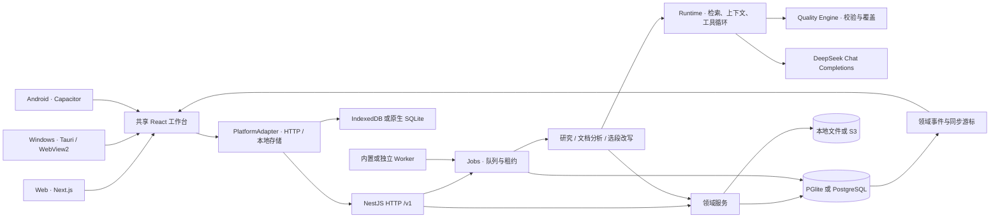
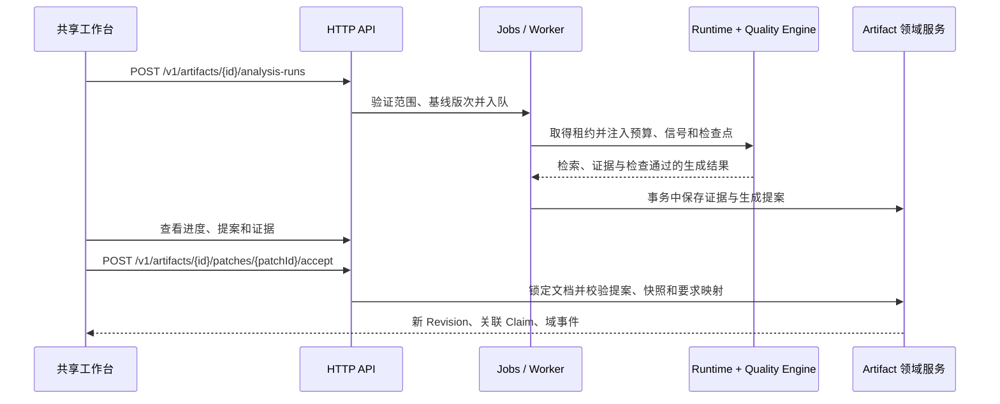

# AI Knowledge Workspace 项目架构设计

更新于 2026-11-14。文档以 F 盘项目的现有实现为准，覆盖三端工作台、服务端任务执行、证据与质量、文档版本和离线同步。

面向前端设计交付的最新版见 [生产力工作空间架构书](PRODUCTIVITY_WORKSPACE_ARCHITECTURE.md)。

## 1. 总体架构



服务端采用模块化单体。Web、Windows 和 Android 共享 React 工作台及 TypeScript/Zod 契约，各平台适配器提供请求、存储和原生能力。客户端保存可同步的工作副本，正式文档版本、来源证据和任务状态由 API 管理。

| 模块 | 职责与边界 |
| --- | --- |
| `apps/api/src/http` | 接收请求、认证、校验输入并分发。OpenAPI 与运行接口在同一服务中维护。 |
| `domain/jobs.ts` 与 `domain/jobs/` | Jobs 持有入队、命令、租约、检查点、终态事务；执行模块通过绑定当次作业的生命周期接口提交结果。 |
| `runtime` | 执行检索、阶段调度、选区改写、上下文组装和模型工具循环。DeepSeek 连接由 gateway 提供。 |
| `quality-engine` | 与 Runtime 同级。维护任务和提示契约、证据与数量门控、语义检查、要求覆盖等。文档写入交给领域服务。 |
| `domain` | Workspace/Project 授权，Source/Evidence/Claim/知识关系，Artifact/Patch/Revision，归档导入导出和同步。 |
| `platform` | SQL 和对象存储边界，以及公网页面获取、安全校验和错误类型。 |
| `packages/contracts` | 跨端 API 类型、文档块格式、图表与投影契约、要求覆盖结构和三方合并函数。 |
| `packages/client` | 导航和同步状态、工作流页面、编辑和渲染、证据检查器、运行回放、平台能力适配。 |

## 2. 主要文件目录树

目录树列出代码入口及本轮涉及的模块，省略依赖、编译产物、测试数据、静态资源和部分同级文件。

```text
ai-knowledge-workspace/
├── apps/
│   ├── api/
│   │   ├── migrations/
│   │   │   ├── 001_core.sql
│   │   │   ├── 002_knowledge.sql
│   │   │   ├── 003_jobs.sql
│   │   │   └── 012_runtime_sessions.sql
│   │   ├── src/
│   │   │   ├── config.ts
│   │   │   ├── main.ts
│   │   │   ├── services.ts
│   │   │   ├── http/
│   │   │   │   ├── app.ts
│   │   │   │   ├── controllers.ts
│   │   │   │   ├── product-controller.ts
│   │   │   │   └── openapi.ts
│   │   │   ├── domain/
│   │   │   │   ├── jobs.ts
│   │   │   │   ├── jobs/
│   │   │   │   │   ├── job-types.ts
│   │   │   │   │   ├── analysis-execution.ts
│   │   │   │   │   ├── research-execution.ts
│   │   │   │   │   ├── model-invocation.ts
│   │   │   │   │   └── external-access.ts
│   │   │   │   ├── access.ts
│   │   │   │   ├── knowledge.ts
│   │   │   │   ├── retrieval.ts
│   │   │   │   ├── ai-evidence.ts
│   │   │   │   ├── document-analysis.ts
│   │   │   │   ├── artifacts.ts
│   │   │   │   ├── sync.ts
│   │   │   │   ├── exports.ts
│   │   │   │   └── imports.ts
│   │   │   ├── runtime/
│   │   │   │   ├── agent.ts
│   │   │   │   ├── document-research.ts
│   │   │   │   ├── selection.ts
│   │   │   │   ├── providers.ts
│   │   │   │   ├── public-research.ts
│   │   │   │   ├── budget.ts
│   │   │   │   └── harness/
│   │   │   │       ├── adapter.ts
│   │   │   │       ├── context.ts
│   │   │   │       ├── loop.ts
│   │   │   │       ├── primary-sources.ts
│   │   │   │       └── session.ts
│   │   │   ├── quality-engine/
│   │   │   │   ├── task-contract.ts
│   │   │   │   ├── prompts.ts
│   │   │   │   ├── document-quality.ts
│   │   │   │   ├── research-operators.ts
│   │   │   │   ├── requirement-ledger.ts
│   │   │   │   ├── evidence-checks.ts
│   │   │   │   └── selection-review.ts
│   │   │   ├── platform/
│   │   │   │   ├── database.ts
│   │   │   │   ├── objects.ts
│   │   │   │   ├── public-web.ts
│   │   │   │   └── security.ts
│   │   │   └── worker/
│   │   │       ├── main.ts
│   │   │       └── loop.ts
│   │   └── tests/
│   │       ├── core.test.ts
│   │       ├── harness.test.ts
│   │       └── deepseek-live.ts
│   ├── web/
│   │   ├── app/{page.tsx,workspace-client.tsx}
│   │   ├── next.config.ts
│   │   └── public/sw.js
│   ├── windows/
│   │   ├── src/{main.tsx,platform.ts}
│   │   └── src-tauri/src/{main.rs,storage.rs,transport.rs,files.rs}
│   └── mobile/
│       ├── src/{main.tsx,platform.ts}
│       ├── capacitor.config.ts
│       └── android/app/src/main/java/com/akw/workspace/
│           ├── MainActivity.java
│           └── WorkspaceBridge.java
├── packages/
│   ├── contracts/src/
│   │   ├── index.ts
│   │   ├── workspace-blocks.ts
│   │   ├── projection.ts
│   │   ├── chart-scene.ts
│   │   ├── requirement-ledger.ts
│   │   └── merge.ts
│   └── client/src/
│       ├── lib/{api.ts,platform.ts,local-repository.ts}
│       └── workspace/
│           ├── workspace-app.tsx
│           ├── document-canvas.tsx
│           ├── artifact-editor.tsx
│           ├── artifact-renderer.tsx
│           ├── projection-views.tsx
│           ├── selection-proposals.tsx
│           ├── document-analysis.tsx
│           ├── runtime-timeline.tsx
│           ├── workflow-status.ts
│           ├── research-page.tsx
│           ├── sources-page.tsx
│           ├── knowledge-page.tsx
│           └── export-center.tsx
├── tests/e2e/workspace.spec.ts
├── audit/v2-delivery/
├── docs/engineering/PROJECT_ARCHITECTURE.md
├── .github/workflows/ci.yml
├── compose.yaml
└── package.json
```

## 3. 本轮重构与约束

| 修改点 | 拆分结果 |
| --- | --- |
| `jobs.ts` 约 840 → 377 行 | 提取文档分析、独立研究和模型调用，保留 SQL 任务状态在 Jobs。两类工作流各自组织依赖，共用调用与预算逻辑。 |
| `workflows.tsx` 约 480 行 | 拆为研究、来源、知识和导出四页，每页约 90–155 行。通用运行状态标签移到 `workflow-status.ts`，文档分析和桌面 Hook 可直接引用。 |
| `workspace-app.tsx` | 提取正文与投影视图的 `DocumentCanvas`，以及选区提交与差异查看的 `SelectionProposals`。WorkspaceApp 继续负责导航、离线同步和跨面板状态。 |

本轮沿用既有 API 路径、状态、工作流版本、数据库迁移和权限判定。提取执行模块时保持租约检查、作业成功与提案写入的事务边界，以及模型请求前后的预算、计量和故障事件顺序。前端仍由同一个工作台响应浏览器或原生适配器。

## 4. 文档分析与研究的执行路径



- **队列与恢复。** Worker 使用作业行锁获取租约，更新心跳和检查点。域写入前锁定并复核租约，取消清理租约，运行中的 Worker 通过心跳发现并中止。已完成的步骤可从检查点恢复。会话支持进度回放。配置恢复密钥后，模型回合及工具结果记录到加密日志，Worker 重领后从持久化边界续跑。
- **模型边界。** `bindJobModel` 绑定作业、用户、权限和证据版本，预留额度后选择非流式 DeepSeek 或 SSE，处理有限重试，记录用量和已脱敏的事件。新 Runtime 默认关闭，按 Workspace 白名单或隔离本机总开关准入。只读原文工具限定为本次准备的证据，不持有业务写权限。
- **证据与覆盖。** 研究可以结合指定材料、工作区全文与可选向量检索、已审知识回召、公开索引。通用 Web 搜索依赖外部配置。质量层分别记录来源、证据、回答和产物；强制项和图像实际交付由门控检查。采纳前复核提案哈希和证据快照，最终版次反查已覆盖块并绑定本次记录。
- **研究入口。** `/v1/research-runs` 支持即时回答、来源摘录和研究报告。即时回答可返回文本；独立研究有证据时可创建新文档与待审核 Claim。文档分析和选段改写都从现有文档发起，用户通过独立的 Patch 采纳接口更新文档。

### 目标驱动的学习产物

首页提交学习目标后，Jobs 按计划、资料、初稿、复核记录检查点，再将课程正文、引用、知识节点和投影保存为一个 Artifact。跟进问题绑定当前 Revision，由同一个 Worker 入口更新该产物。练习成绩按用户保存在 014 迁移表，可供下次追问使用，并通过题目内容校验决定是否跨版本继承。详见 [Windows 学习产物实测](../../audit/learning-workspace/WINDOWS_ACCEPTANCE.md)。

## 5. 数据、版本、渲染与同步

| 数据 | 关系与典型读写路径 |
| --- | --- |
| Workspace / Project | 成员角色控制 Workspace，来源、文档和知识节点可限定项目。项目关联可扩大明确允许的引用范围。 |
| Source / Evidence / Claim | Source 关联 Snapshot，Document 解析为 Passage，Evidence 保存原文位置。Claim 通过关系表连接 Evidence，受来源状态和版本影响。 |
| Artifact / Revision / Patch | Artifact 指向当前不可变 Revision；版本内容为结构块及引用。Patch 以基线版本为输入，采纳产生新版本。 |
| Job / Runtime Session / Sync | Job 保存业务输入、状态和检查点，SSE 试点另存会话进度和可选的加密回合日志。领域 outbox 通过拉取游标同步文档或知识变化。 |
| Asset / Export | 附件与生成文件由对象存储保存。导出按文本、版本和素材权利读取，可生成 Markdown、JSON、PDF、DOCX、归档和支持的视图格式。 |

正文、证据网络、时间脉络、思维导图、关系与依赖图以及数据图表由文档块或知识投影输入驱动。正文编辑、提案预览及其他画布可调用注册式渲染器。换主题或图形组件时可从渲染注册表切入，块格式和实体 ID 可继续复用。

离线时客户端先持久化草稿。重新联网后，`local-repository.ts` 使用 mutation ID、设备序号与基线版次提交；服务器在同一个事务内单调推进设备序号并尝试合并，409 冲突保留本机草稿供用户处理。推送只确认变更，拉取事件成功后才保存拉取游标。Web 存在 IndexedDB/Service Worker，Windows 和 Android 经原生桥接持久化 SQLite。

## 6. 核心代码摘录

下列代码从当前文件摘录，保留关键逻辑并省略非相关段落。

### 作业派发和生命周期

[Jobs.execute](../../apps/api/src/domain/jobs.ts) 将当次作业的 lease、事件、checkpoint 与 completion 绑定为执行上下文。

```ts
    const run:RunningJob={ job,actor,signal,lifecycle:{
      assertLease:(sql,lock)=>this.assertLease(sql,job,lock),
      event:(sql,type,payload)=>this.jobEvent(sql,job.id,type,payload),
      record:(type,payload)=>this.record(job,type,payload),
      save:(type,payload,companion)=>this.save(job,type,payload,companion),
      complete:(status,produce)=>this.complete(job,actor,status,produce),
    } };
    const { db,artifacts,knowledge,search,embed,publicResearch }=this;
    const model=bindJobModel(run,{ db,artifacts,model:this.model,streamingGateway:this.harness?.gateway });

    // 省略选段改写分支。
    if (input.kind === 'analysis') {
      await executeAnalysis(run,input.body,{ db,artifacts,knowledge,embed,publicResearch,model });
      return;
    }
    await executeResearch(run,input.body,{ db,artifacts,knowledge,search,embed,model:this.model ? model : undefined });
```

### 四层覆盖和提案落地

[质量引擎](../../apps/api/src/quality-engine/requirement-ledger.ts) 对实际产物块和引用核查。分析在 [analysis-execution.ts](../../apps/api/src/domain/jobs/analysis-execution.ts) 中先写提案，领域服务在 [artifacts.ts](../../apps/api/src/domain/artifacts.ts) 的采纳事务复核最终 Revision。

```ts
  const required=items.filter(item=>item.mandatory);
  const mandatory=Object.fromEntries(stages.map(stage=>[stage,{
    total:required.length,completed:required.filter(item=>item.status[stage]==='complete').length,
  }])) as RequirementLedger['mandatory'];
  return { version:2,items,mandatory,gate:required.some(item=>item.status.artifact!=='complete') ? 'blocked'
    : items.some(item=>item.status.artifact!=='complete') ? 'pass_with_disclosed_gaps' : 'pass' };
```

### 统一渲染入口

[artifact-renderer.tsx](../../packages/client/src/workspace/artifact-renderer.tsx) 提供渲染注册表及 Provider。新 [document-canvas.tsx](../../packages/client/src/workspace/document-canvas.tsx) 共享同一套图形和正文组件。

```tsx
export function createArtifactRendererRegistry(overrides:BlockRendererRegistry = {}):BlockRendererRegistry {
  return Object.freeze({ ...builtIn,...overrides });
}
export const defaultArtifactRenderers = createArtifactRendererRegistry();
const ArtifactRenderers = createContext(defaultArtifactRenderers);
export function ArtifactRendererProvider({ registry,children }:{ registry:BlockRendererRegistry; children:ReactNode }) {
  return <ArtifactRenderers.Provider value={registry}>{children}</ArtifactRenderers.Provider>;
}
```

### 客户端提交幂等同步

[sync.ts](../../apps/api/src/domain/sync.ts) 按工作空间、设备顺序与基线版本应用客户端变更。

```ts
return this.db.transaction(async sql => {
  await workspace(sql, actor, mutation.workspace_id, true);
  return idempotent(sql, actor, 'sync.mutation', mutation.mutation_id, mutation, async () => {
    const state = await first<{ deleted_at:Date|null }>(sql,'SELECT deleted_at FROM artifacts WHERE id=$1 AND workspace_id=$2',
      [mutation.entity_id,mutation.workspace_id]);
    if (!state) throw invalid('Mutation workspace and resource do not match');
    if (state.deleted_at) throw conflict('CONFLICT_ARTIFACT_DELETED','Document is in the trash. The local draft is preserved.');
    const artifact = await this.artifacts.get(actor, mutation.entity_id, sql);
    const device = await first<{ last_sequence: number }>(sql,
      'SELECT last_sequence FROM devices WHERE workspace_id=$1 AND user_id=$2 AND id=$3',
      [mutation.workspace_id, actor.user, mutation.device_id]);
    if ((device?.last_sequence ?? 0) >= mutation.client_sequence) throw conflict('CONFLICT_DEVICE_SEQUENCE', 'Client sequence was already used');
    const revision = await this.artifacts.editIn(sql, actor, artifact, mutation.payload, 'user', true, mutation.base_version);
    await sql.all(`INSERT INTO devices(workspace_id,user_id,tenant_id,id,last_sequence) VALUES($1,$2,$3,$4,$5)
      ON CONFLICT(workspace_id,user_id,id) DO UPDATE SET last_sequence=EXCLUDED.last_sequence,updated_at=now()`,
      [mutation.workspace_id, actor.user, actor.tenant, mutation.device_id, mutation.client_sequence]);
    const row = await first<{ cursor: string }>(sql, 'SELECT COALESCE(MAX(server_sequence),0)::text AS cursor FROM domain_outbox WHERE workspace_id=$1', [mutation.workspace_id]);
    return { mutation_id: mutation.mutation_id, acknowledged: true, cursor: row!.cursor, revision };
  });
});
```

## 7. 验证与已知边界

| 验证项 | 本轮结果 |
| --- | --- |
| npm test | 45 项通过，覆盖权限、模型输出、采纳冲突、阶段恢复、取消和引用。 |
| npm run typecheck / lint | 两项通过，含 API、Web、Windows 和 Android 的 TypeScript 类型检查。 |
| npm run test:e2e | 8 项通过，含离线编辑、证据、视图、导出和文档恢复。 |
| npm run test:deepseek | 4 项通过，覆盖真实即时回答、研究证据、选区改写、分析采纳。 |
| SSE 工作台定向复跑 | 3 项通过，含必答问题分析、取消后刷新、引用改写。 |
| Windows 新构建与原生冒烟 | 通过，覆盖 WebView2、SQLite 离线重启与重连同步、公式、图表和 PDF。 |
| 隔离 PostgreSQL 17.11 | 两个连接池处理 48 个作业，重复入队幂等、过期租约重领通过。 |

- PostgreSQL 复跑按隔离负载验证了队列事务和重领，脚本省略了 pgvector 和完整领域迁移。全量部署、生产 S3 与灾备不由该结果推定。
- 工作台 3 个真实模型 SSE 场景验证了本轮影响的链路，开放域召回和生成质量仍沿用 [v2.0 的验收结论](../../audit/v2-delivery/FINAL_DELIVERY.md)。升级后，可配置加密消息日志，从已提交的模型回合与只读工具结果继续。尚未提交的提供方响应仍需重试。分析提案自动添加证据网络，覆盖的结论可以跳转至当前正文。任务自适应多视图和生产灰度结论见 [升级规划验收](../../audit/upgrade-v1/PHASE_REPORT.md)。
- `workspace-app.tsx` 仍集中管理同步、导航和文档状态联动。它是三端共用入口。涉及其进一步拆分时应先验证切换工作空间、回收站、重连以及长时间并发编辑的状态交接。
