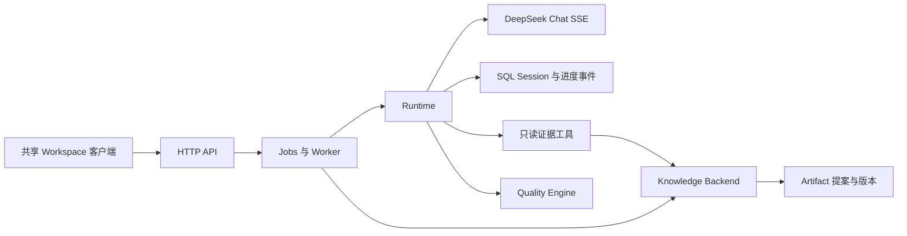

# Phase 03 架构决策

| ADR | 决策 |
|---|---|
| 001 Runtime | 新运行由服务端 Workspace 白名单路由，持久化运行归属。旧 Runtime 保持默认。 |
| 002 事件 | Session 与 Job 关联独立标识，持久化有序白名单事件，原有领域事件和同步协议保留。 |
| 003 Loop | 每个受控工作流对应一次任务；模型工具调用仅在明确的阶段打开，有限步数，重领利用既有领域检查点。 |
| 004 工具 | 输入 schema、当前候选 scope、授权复核、超时、只读与重复限制。模型无任意网络地址和写能力。 |
| 005 Prompt | 现有任务模板为稳定 section，技能内容单独有版本，检索正文只作为数据。 |
| 006 Context | 按任务和模型预算核算请求，不静默删任务要求。 |
| 007 Compaction | 优先裁剪可重读的证据摘录，不裁剪工具调用与结果配对。原文在来源表。 |
| 008 Skills | 发布内置技能按任务注册、加载和计量。 |
| 009 Model | Chat Completions SSE，保持非思考模式默认，内部协议字段不向 UI 发送。 |
| 010 Knowledge | 持久化经既有领域服务和提案采纳。 |
| 011 Explainability | 从经过白名单过滤的事件重建进度、工具、覆盖及警告。 |
| 012 Deployment | 本机隔离基准和小范围试点，关闭新入队路由后旧路径接管。正式切流等待质量和基础设施验证。 |

主要接口为 `StreamingGateway.complete(request, signal)`、`runToolLoop` 和带 cursor 的 Session 投影。Runtime 不直接接受客户端注入的工具或未经确认的权限。
