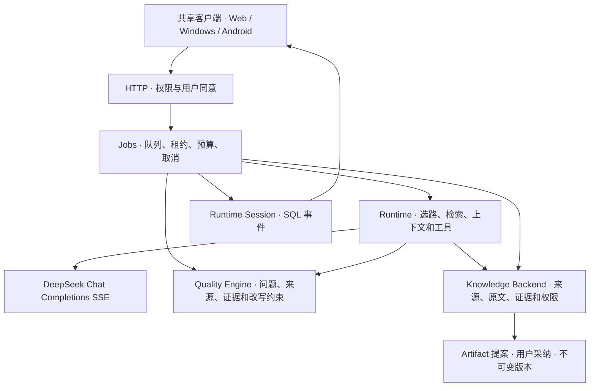
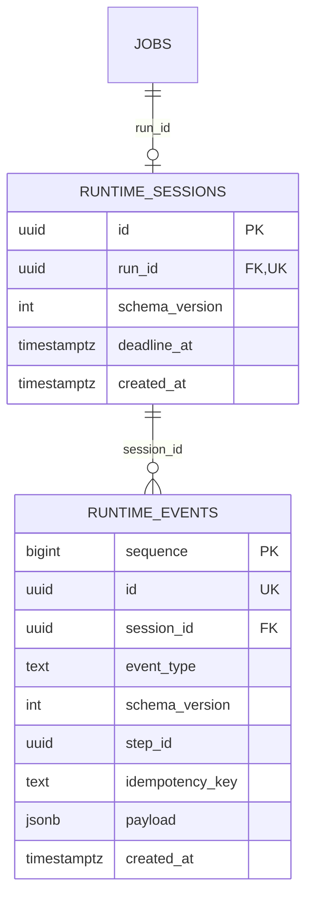

# Harness 运行时与质量引擎契约

| 模块 | 接口及职责 |
| --- | --- |
| Runtime | `runtime/harness/adapter.ts` 的 `StreamingGateway.complete(request, signal)`，`loop.ts` 的 `runToolLoop`，`context.ts` 的 `runtimePrompt`，`session.ts` 的会话、事件与灰度。 |
| Quality Engine | 与 Runtime 同级。任务提示和版本、输出结构、引用匹配、数量与适用条件检查、覆盖、修复上限。程序先校验结构和引用，模型核对语义。 |
| Knowledge Backend | 已有工作空间、来源、文档、片段、证据和 Artifact 服务。验证当次可读证据及内容；采纳仍走已有事务和版本控制。 |
| 客户端 | `packages/client/src/workspace/runtime-timeline.tsx` 消费带游标的安全投影。运行结果通过工作流原有的提案与检查器展示。 |

迁移 `apps/api/migrations/012_runtime_sessions.sql` 新建两表及 `(session_id,sequence)` 索引，两个外键级联删除。会话按 Job 唯一，幂等键在会话内唯一。历史 Job 无需回填；首次取得租约时以数据库时间固定绝对截止。任务归属和工具、技能、压缩开关写入检查点，重启和接管沿用。已有领域事件和同步游标照常读取。

## HTTP 与事件

- `GET /v1/openapi.json` 查看运行实例接口。
- `GET /v1/runtime-runs/{id}` 返回 `run_id`、`session_id`、`status`、`watermark`。路径 ID 是工作流的 run_id。
- `GET /v1/runtime-runs/{id}/events?cursor=0` 返回 `events`、`next_cursor`、`has_more`，每页至多 100 条。使用字符串游标。事件包括 `sequence,event_id,session_id,event_type,schema_version,step_id,payload,created_at`。
- `POST /v1/runtime-runs/{id}/cancel` 支持 `Idempotency-Key`。通过 Job 和工作空间的授权检查，终止可取消状态并中止调用，已有文档版次不受影响。旧版任务使用原工作流端点。
- 文档分析新增 `required_source_urls` 和 `required_questions`。指定来源需要取得正文且进入通过门控的引用；手填必答问题全部被覆盖才生成提案。自动拆分的普通问题可保留经检查的部分结果，并显示覆盖缺口。

| 事件 | 允许的主要载荷 |
| --- | --- |
| `session.created` | 工作流类别 |
| `turn.started` / `turn.resumed` / `turn.finished` | 尝试序号或结束状态 |
| `step.started` / `step.finished` | prompt ID、section ID、技能 ID；状态或错误码 |
| `model.request` / `model.response` / `model.failed` | 调用序号、prompt ID、finish reason、用量或错误码 |
| `tool.started` / `tool.finished` | 工具名、调用 ID、执行状态 |
| `context.compacted` | 策略版本、裁剪前后字节数、受影响证据 ID |
| `quality.finding` / `artifact.proposed` | 门控错误码或提案 ID |

## 工具、模板和执行配置

- 工具 `read_evidence_excerpt` 仅接受 `{"evidence_id":"<UUID>"}`，未知字段或当前候选集外 ID 拒绝。读取前复核授权和来源；单次工具限时 3.5 秒，最多 2 轮工具、3 次调用。工具输入、原文和模型推理字段不进入进度事件。
- 提示注册表在 `apps/api/src/quality-engine/prompts.ts`。每项有 `id`（对象键）、`version`、`format`、`schema`、`system`。系统模板先于受信技能，目标、正文、检索证据进入用户数据包。
- `source-analysis.v1` 绑定文档初稿，`faithful-edit.v1` 绑定选区初稿。技能是随应用发布的受信文本；执行记录包含技能 ID。无工作空间动态技能装载。
- Agent Profile 以当前配置的 DeepSeek 模型经 Chat Completions 执行，默认非思考；文档初稿可读受控证据，其余阶段按工作流门控。会话对应一个 Job，恢复到领域阶段检查点。
- `excerpt_preview.v1` 只缩短可授权回读的长摘录，保留用户目标、必答要求、引用和精确摘录选项。请求采用保守字节上界预约额度，供应商用量进入结果事件。
